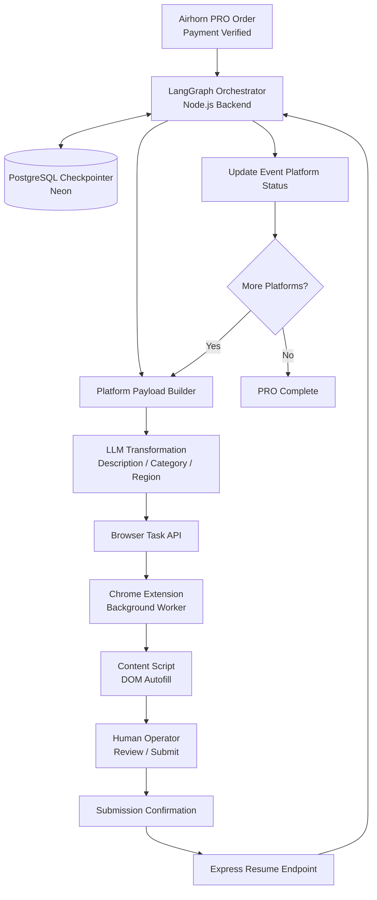

# Event Automation Architecture Blueprint

## 1. System Overview & Core Flow

This document defines the hybrid automation architecture for publishing calendar events across `N` third-party event platforms. It combines a structured **Service API** for state and data management with a **Chrome Extension** for browser-based DOM injection and **Human-in-the-Loop (HITL)** verification.

```
+-------------------+            GET /events/:eventId            +----------------------------------+
|                   | -----------------------------------------> |                                  |
|  Event Database   |                                            |  Chrome Extension                |
|  & Service API    | <----------------------------------------- |  (Background Service Worker)     |
|                   |   PATCH /events/:eventId/platforms/:plat   |                                  |
+-------------------+                                            +----------------------------------+
                                                                                  |
                                                                                  | Orchestrates Tab Loop (1..N)
                                                                                  v
                                                                 +----------------------------------+
                                                                 | [Content Script (DOM Injection)] |
                                                                 +----------------------------------+
                                                                                  |
                                                                                  | Pauses for CAPTCHA / Review
                                                                                  v
                                                                 +----------------------------------+
                                                                 |   Human-in-the-Loop (Operator)   |
                                                                 |   - Solves CAPTCHA               |
                                                                 |   - Reviews & Clicks 'Submit'    |
                                                                 +----------------------------------+
                                                                                  |
                                                                                  | Detects Submission
                                                                                  v
                                                                 +----------------------------------+
                                                                 | [Network / URL Completion        |
                                                                 |  Listener]                       |
                                                                 +----------------------------------+
                                                                                  |
                                                                                  +---> (Loop Next Platform)
```

---

## 2. Architectural & Orchestration Patterns

### 2.1 Agentic Workflow / Orchestrator
* **Role:** Acts as the central loop controller managing the lifecycle of a batch publishing run for a single `event_id`.



* **Execution Loop:**
  1. Fetch canonical event payload and the `platforms` array via `GET /events/:eventId`.
  2. Verify `is_locked === true` (confirming the associated order has been paid with a non-null `order.payment_completed_at`) and filter for entries where `status === "not_started"`.
  3. For each pending platform:
     * Open or reuse a dedicated browser tab pointed at the platform's submission form URL.
     * Trigger `[Content Script (DOM Injection)]` to populate form fields using the event payload and `address_fields`.
     * Transition state to `AWAITING_HUMAN` and display an operator status overlay.
     * Wait for `[Network / URL Completion Listener]` to confirm submission.
     * Report completion (`published_url`, `date_published`, `tracking_code`) via `PATCH /events/:eventId/platforms/:platform` and advance `(Loop Next Platform)`.

### 2.2 Human-in-the-Loop (HITL)
* **Trigger Conditions:**
  * Presence of CAPTCHA / reCAPTCHA / hCaptcha challenges.
  * Platform-specific required fields that cannot be deterministically mapped (e.g., custom subcategory dropdowns or image cropping).
  * Final submission confirmation (`Submit` / `Publish` button click).
* **Operator Controls:**
  * **Resume / Next:** Manual override if the completion listener misses a custom redirect.
  * **Skip Platform:** Marks platform as `skipped` without halting the remaining queue.
  * **Abort Run:** Cleanly exits the loop while preserving completed platform progress in the Service API.

### 2.3 Finite State Machine (FSM)
Tracks both the overall batch run and each individual platform entry inside `platforms[]`.

| State | Description | Entry Trigger | Exit Trigger |
| :--- | :--- | :--- | :--- |
| `not_started` | Platform is queued and ready for submission. | Event record created/imported (`imported_from`) and payment verified (`is_locked: true`). | Orchestrator picks platform from queue. |
| `in_progress` | Browser tab opened; Content Script is injecting DOM values. | Tab finishes loading target form URL. | `[Content Script (DOM Injection)]` completes field population. |
| `awaiting_human` | Form is pre-filled; paused for CAPTCHA and human review. | DOM injection finishes without fatal errors. | Human clicks `Submit` or triggers manual override. |
| `submitted` | Form submission confirmed by listener; `published_url` recorded. | `[Network / URL Completion Listener]` detects confirmation. | Terminal state for this platform; triggers `(Loop Next Platform)`. |
| `failed` / `skipped` | Submission failed or was bypassed by the operator. | Timeout, DOM error, or operator clicks `Skip`. | Terminal state for this platform; triggers `(Loop Next Platform)`. |

---

## 3. Data & Integration Layer

### 3.1 Canonical Event JSON Schema
Standardized payload served by the backend database. Includes event metadata, organizer details, S3 media asset URL, parsed address components, and per-platform tracking objects with `tracking_code` identifiers.

```json
{
  "event_id": "693a8111-dfcd-46ca-9e83-064117fb7f07",
  "title": "Friday Night Funnies",
  "name": "Comedy Oakland",
  "description": "Real Comedians, 1 Stage, 0 Algorithms. Experience standup comedy at its finest. East Bay Express Reader's Poll Best Comedy Night Winner.",
  "start_datetime": "2027-02-19T19:30:00-08:00",
  "end_datetime": null,
  "location_name": "Quinn's Lighthouse",
  "address": "1951 Embarcadero, Oakland, CA 94606",
  "address_fields": {
    "street": "1951 Embarcadero",
    "city": "Oakland",
    "state": "CA",
    "zip": "94606"
  },
  "price": "$25",
  "image": "https://s3.us-west-1.amazonaws.com/airhorn.events.images/events/aa73e9fd-c367-4154-842c-a808eb37709b.png",
  "website": "https://www.comedyoakland.com/",
  "email": "info@ComedyOakland.com",
  "organization": "Comedy Oakland",
  "phone": "(510) 214-2626",
  "category": "Comedy",
  "imported_from": "https://docs.google.com/spreadsheets/d/17JOQAasSjZ4UROKey_an4WxU6lmjV6tS8VGekce_Jgs/edit?gid=1696435403#gid=1696435403",
  "platforms": [
    {
      "platform": "funcheapsf",
      "status": "not_started",
      "external_url": null,
      "published_url": null,
      "date_published": null,
      "tracking_code": 3720
    },
    {
      "platform": "visitoakland",
      "status": "not_started",
      "external_url": null,
      "published_url": null,
      "date_published": null,
      "tracking_code": 3721
    },
    {
      "platform": "sfstation",
      "status": "not_started",
      "external_url": null,
      "published_url": null,
      "date_published": null,
      "tracking_code": 3722
    },
    {
      "platform": "indybay",
      "status": "not_started",
      "external_url": null,
      "published_url": null,
      "date_published": null,
      "tracking_code": 3723
    },
    {
      "platform": "dothebay",
      "status": "not_started",
      "external_url": null,
      "published_url": null,
      "date_published": null,
      "tracking_code": 3724
    },
    {
      "platform": "eastbaymagazine",
      "status": "not_started",
      "external_url": null,
      "published_url": null,
      "date_published": null,
      "tracking_code": 3725
    },
    {
      "platform": "eastbaytimes",
      "status": "not_started",
      "external_url": null,
      "published_url": null,
      "date_published": null,
      "tracking_code": 3726
    },
    {
      "platform": "patch",
      "status": "not_started",
      "external_url": null,
      "published_url": null,
      "date_published": null,
      "tracking_code": 3727
    },
    {
      "platform": "metrosiliconvalley",
      "status": "not_started",
      "external_url": null,
      "published_url": null,
      "date_published": null,
      "tracking_code": 3728
    }
  ],
  "is_locked": true
}
```

#### Field Notes
* **`title` vs. `name`:** `title` is the public, publishable name of the event, whereas `name` serves as the internal identifier (both values can be identical).
* **`start_datetime` & `end_datetime`:** Stored as standard RFC 3339 timestamp strings (e.g., `2027-02-19T19:30:00-08:00`).
* **`address`:** Full unparsed venue address string; expected to include city, state, and zip code.
* **`address_fields`:** Structured object (`street`, `city`, `state`, `zip`) derived from `address` to simplify direct injection into multi-field platform forms.
* **`image`:** When uploaded via the UI from a user's desktop, the file is stored on Amazon S3 and its static link is saved here; users can manually override this with a different static image URL.
* **`website`:** Primary destination URL for the listing (e.g., Event page, Promoter site, Event Feature, or Ticket Purchasing link) at the user's discretion.
* **`imported_from`:** Stores the source URI if the event was imported from an external platform (such as a **Facebook Event**, **Eventbrite Event**, or **Google Sheets**); otherwise `null`.
* **`is_locked`:** Evaluates to `true` when the event has an associated order where `order.payment_completed_at` is not `null` (confirming the order has been paid).

---

### 3.2 Tool Calling / Service API Endpoints
Stateless REST endpoints consumed by the Chrome Extension Background Service Worker (or AI Orchestrator) to retrieve event payloads and persist platform progress.

* **`GET /events/:eventId`**
  * **Purpose:** Retrieves the canonical event object and its `platforms` array along with their current statuses.
  * **Response (`200 OK`):** Returns the canonical event JSON payload.

* **`PATCH /events/:eventId/platforms/:platform`**
  * **Purpose:** Updates an individual event platform's status and submission metadata inside `platforms[]`.
  * **Headers:** `Idempotency-Key: {eventId}_{platform}_{tracking_code}`
  * **Request Body:**
    ```json
    {
      "status": "submitted",
      "external_url": "https://sf.funcheap.com/submit-event/",
      "published_url": "https://sf.funcheap.com/2027/02/19/friday-night-funnies-oakland/",
      "date_published": "2026-11-16T20:30:00-08:00",
      "tracking_code": 3720
    }
    ```

---

### 3.3 Schema Mapping & Data Normalization
* **Field Normalization Rules:**
  * `start_datetime` (RFC 3339) is parsed and formatted into platform-specific date and time input strings (e.g., `MM/DD/YYYY` + `7:30 PM`).
  * `end_datetime`: When `null`, defaults to `start_datetime + 2 hours` on platforms that strictly require an end time.
  * `address` & `address_fields`: The full `address` string is parsed into `address_fields` (`{ street, city, state, zip }`) so adapters can map either the single combined string or individual location inputs depending on the target form's DOM structure.
  * `tracking_code`: Appended as a query/UTM parameter (e.g., `?ref=3720`) to `website` when supported, enabling attribution tracking per listing.
* **AI Semantic Mapping (Optional):** Maps generic `category` (`"Comedy"`) and `price` (`"$25"`) to platform-specific dropdown option values (e.g., `funcheapsf`, `dothebay`, `sfstation`).

---

### 3.4 Idempotency & Duplicate Prevention
* **Composite Idempotency Key:** Constructed as `{eventId}:{platform}:{tracking_code}` (e.g., `693a8111-dfcd-46ca-9e83-064117fb7f07:funcheapsf:3720`).
* **Guardrails:**
  * Before opening a platform tab, the orchestrator verifies `status === "not_started"` and `published_url === null`.
  * If a browser crash or page reload occurs after submission, retrying the `PATCH` request with the same `Idempotency-Key` safely returns the existing updated record without overwriting `date_published`.

---

## 4. Browser & UI Automation Layer (Chrome Extension)

### 4.1 Background Service Worker (`background.js`)
* **Responsibilities:**
  * Holds active loop state in `chrome.storage.session` (survives worker idle sleep).
  * Communicates indirectly with the Service API. Sends messages to event listeners in Airhorn.events site, which then calls Service API to manage Event state:
    - OPEN_SUBMISSION_WINDOWS - uses `chrome.windows.create` to create popup windows from URLs passed in the message. Return window and tab ids.
    - CLOSE_SUBMISSION_WINDOWS - uses `chrome.windows.remove` to close popup windows by ids passed into this message: platformWindowId, messageWindowId.
    - SET_EVENT - saves Event payload in `chrome.storage.local`, later referred to by Content Scripts.
    - FORM_SUBMITTED - sends event PLATFORM_FORM_SUBMITTED to all tabs with the platform URL and tab id, indicating third-party 'submit' was triggered. Message receiver will update Event status.
  * Manages tab creation, activation, and cleanup (`chrome.tabs`, `chrome.windows`).
  * Routes messages between the extension popup/side-panel and active Content Scripts.

### 4.2 Content Scripts (`content.js`)
* **Responsibilities:**
  * `content.js` runs on Airhorn.events site AND third-party platform. 
     - If running on Airhorn.events site, setup listener for AIRHORN_AUTOFILL_{platform} messages which store the Event payload using `chrome.storage.local.set()`.
     - If running on third-party platform, detect which platform then run the DOM Injection script.
  * Injected into matched third-party form domains (e.g., `funcheapsf`, `visitoakland`, `sfstation`, `indybay`, `dothebay`, `eastbaymagazine`, `eastbaytimes`, `patch`, `metrosiliconvalley`).
  * Listen for message AIRHORN_AUTOFILL_{platform} and store Event payload in `chrome.storage.local`.
  * Executes `[Content Script (DOM Injection)]` using platform-specific adapter modules (see `detectPlatform()`)
  * Renders a lightweight floating HITL banner/widget showing current progress (e.g., `Platform 2 of 9: visitoakland | Tracking: 3721`) and manual `Skip` / `Done` controls.

### 4.3 DOM Injection Strategy
* **Adapter Pattern:** One mapping module per target platform (e.g., `adapters/funcheapsf.js`, `adapters/dothebay.js`).
* **Framework-Compatible Input Filling:**
  * Dispatches native `input`, `change`, and `blur` events after setting values so React/Vue/Angular forms register state updates.
  * Handles rich-text editors (`contenteditable`), date/time pickers, and S3 image URL fetching/file-input uploads (`DataTransfer` API) for `image`.

### 4.4 Event Listener / Network Completion Listener
* **Completion Detection Mechanisms (in priority order):**
  1. **Network Intercept (`chrome.webRequest` / `fetch` wrapper):** Listens for `200 OK` / `302 Found` responses on the platform's form submission endpoint and extracts `published_url` if returned.
  2. **URL Navigation Change (`chrome.tabs.onUpdated`):** Detects transitions from `/submit` or `/create` to confirmation/listing URLs.
  3. **DOM Confirmation Observer (`MutationObserver`):** Watches for platform-specific success banners (e.g., *"Thank you! Your event has been submitted"*).
  4. **Manual Human Fallback:** Operator clicks **"Mark Submitted & Next"** in the floating HITL overlay.

---

## 5. Security, Reliability & Guardrails

* **Authentication:** Short-lived Bearer token or API key stored securely in `chrome.storage.local` for Service API requests.
* **Domain Allowlisting:** `manifest.json` restricts host permissions strictly to the approved third-party event platforms and your Service API domain.
* **Order & Payment Gate (`is_locked`):** Automation runs are permitted only when `is_locked === true` (confirming `order.payment_completed_at` is non-null and preventing unpaid submissions or edits to paid event details).
* **No Auto-Submit Policy:** Extension scripts are strictly prohibited from programmatically clicking final submit buttons on third-party forms; human action is always required.

---

## 6. Implementation Roadmap

* [x] **Phase 1: Canonical Schema & Core Loop Design** — Define real event JSON structure (including RFC 3339 timestamps, `address_fields`, `is_locked` payment state, and `platforms[]` tracking codes) and FSM lifecycle.
* [ ] **Phase 2: Service API & Persistence** — Implement `GET /events/:eventId` and idempotent `PATCH /events/:eventId/platforms/:platform` endpoints.
* [ ] **Phase 3: Chrome Extension Service Worker** — Build `chrome.storage.session` state machine, tab orchestrator, and API client.
* [ ] **Phase 4: Platform DOM Adapters & HITL Overlay** — Implement adapters for the 9 Bay Area platforms (`funcheapsf` through `metrosiliconvalley`), S3 image upload helper, and floating operator banner.
* [ ] **Phase 5: Completion Listeners & Testing** — Add URL/network/DOM completion detection and run end-to-end tests with human CAPTCHA verification.
